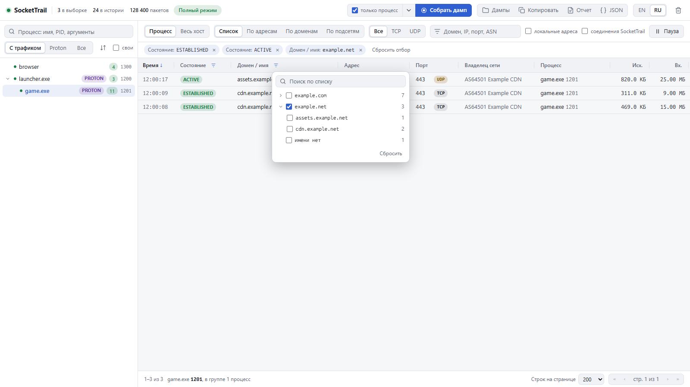
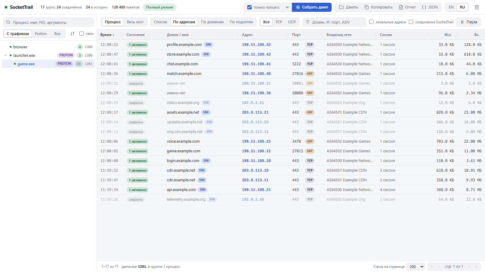
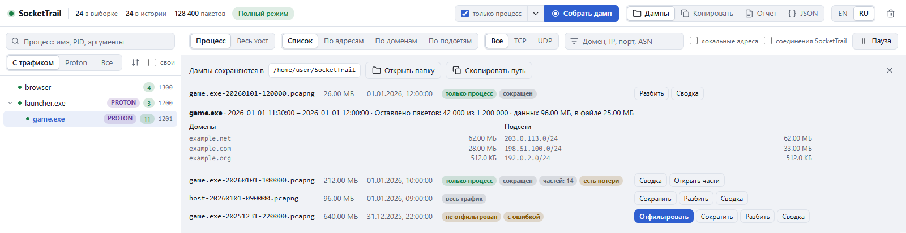

# Руководство

[English](../usage.md) | **Русский** · [К README](../../README.ru.md)

- [Окно](#окно)
- [Выбор процесса](#выбор-процесса)
- [Таблица соединений](#таблица-соединений)
- [Сводки](#сводки)
- [Дампы](#дампы)
- [Отчеты и экспорт](#отчеты-и-экспорт)
- [Откуда берутся имена и порты](#откуда-берутся-имена-и-порты)
- [Командная строка](#командная-строка)
- [Фоновый сбор](#фоновый-сбор)
- [Язык](#язык)
- [Где лежат данные](#где-лежат-данные)

## Окно

SocketTrail открывает собственное окно: Chrome, Chromium, Edge, Brave или Vivaldi в
режиме приложения с отдельным профилем. Оно не смешивается с обычным браузером и
имеет свою иконку на панели задач. Если браузера на Chromium нет, откроется обычная
вкладка.

**Закрытие окна завершает программу**: незаконченный дамп дописывается, кеш имен
сохраняется, захват останавливается. Ctrl+C и SIGTERM делают то же самое.
Повторный запуск не создает вторую копию, а открывает окно уже работающей.

В шапке: счетчики (соединений в выборке, в истории, разобранных пакетов), метка
режима, управление дампом, кнопки **Дампы**, **Копировать**, **Отчет**, **JSON**,
переключатель EN | RU и кнопка очистки истории.

**Полный режим** значит, что захват пакетов работает. **Базовый режим** значит, что он
выключен: остается таблица сокетов, без объема трафика, целей UDP и дампов. На Windows
щелчок по метке перезапускает программу от администратора, см.
[Два режима](windows.md#два-режима).

## Выбор процесса

Слева дерево процессов, оно обновляется само.

- **С трафиком**, **Proton** и **Все** фильтруют дерево, **свои** показывает еще и сам
  SocketTrail с его `dumpcap`. Вкладка **Proton** есть только на Linux. Поиск идет по
  имени, PID и аргументам.
- Дерево упорядочено по имени, поэтому строки стоят на месте. Кнопка со стрелками рядом
  с вкладками упорядочивает его по числу соединений. Процесс остается в списке
  **С трафиком** еще 30 секунд после последней активности, поэтому пауза в обмене его не
  скрывает.
- Зеленая точка — есть активные соединения, число — сколько соединений, плашка
  PROTON — программа под Proton или Wine.
- Вместе с процессом выбираются все его потомки, поэтому игра под Proton видна вместе
  с цепочкой запуска. Десяток одноименных листьев, например вкладки браузера,
  сворачивается в одну строку вида `chrome x12`.
- Когда выбранный процесс завершается, его соединения остаются в таблице, а строка под
  таблицей сообщает об этом.
- Дерево управляется с клавиатуры: стрелки переходят между строками, вправо и влево
  раскрывают и сворачивают ветку, Enter или пробел выбирают процесс.

## Таблица соединений

**Процесс** показывает выбранную группу, **Весь хост** — все соединения компьютера.
**Список** — история построчно, **По адресам**, **По доменам** и **По подсетям** — это
[сводки](#сводки).

<picture>
  <source media="(prefers-color-scheme: dark)" srcset="../images/filters-ru-dark.png">
  
</picture>

- **Сортировка.** Щелчок по заголовку столбца сортирует по нему, следующий меняет
  порядок на обратный. По умолчанию новые соединения сверху. Порядок идет по времени
  появления соединения, а оно не меняется, поэтому строки не меняются местами. Если
  отсортировать **Время** по возрастанию, новые строки появляются внизу и не двигается
  вообще ничего.
- **Отбор по списку.** Значок в заголовке столбца открывает значения этого столбца со
  счетчиками: состояние, домен, адрес, порт, владелец сети, процесс. Поддомены вложены в
  основной домен, а адреса в подсеть, поэтому одна галочка на `example.com` или
  `203.0.113.0/24` охватывает все, что внутри. Значения одного столбца объединяются
  через «или», разные столбцы через «и».
- **Отбор из строки.** Щелчок по состоянию оставляет только это состояние. Значки
  отбора, которые появляются поверх строки, делают то же для ее домена, адреса и
  процесса. Следующий щелчок по тому же значению снимает отбор.
- Активный отбор виден метками над таблицей. У каждой метки своя кнопка удаления, а
  **Сбросить отбор** убирает все сразу.
- **Пауза** останавливает строки. Счетчики в шапке продолжают работать, а сортировка,
  отбор и страницы применяются, когда вы ими пользуетесь.
- **Страницы.** В таблице 100, 200, 500 или 1000 строк на странице, выбор запоминается.
  Передаются только строки текущей страницы, поэтому длинная сессия не тормозит окно.
- Закрытые соединения остаются в списке. Строки с пометкой **только пакеты** пойманы
  разбором пакетов и ни разу не попали в таблицу сокетов: они прожили меньше
  интервала опроса в 250 мс.
- Плашка **SNI** значит, что имя взято из рукопожатия TLS или QUIC этого самого
  соединения. Это самый надежный источник.
- В ячейке порта стоит метка **TCP** или **UDP**. Переключатель **Все / TCP / UDP**
  оставляет в таблице один протокол.
- Поле фильтра ищет по домену, IP, порту, ASN и протоколу: `udp` оставит только UDP.
- **локальные адреса** показывает трафик к 127.0.0.53, mDNS, SSDP и другим локальным
  адресам, **соединения SocketTrail** — служебный трафик самой программы. По умолчанию
  и то и другое скрыто.
- Границы колонок можно тянуть. Двойной клик по границе подгоняет ширину под самое
  длинное значение. Ширины запоминаются, как и ширина левой панели.
- Значок копирования поверх строки кладет домен или адрес в буфер обмена.

Домены появляются постепенно. DNS-ответ виден один раз, когда программа разрешает
имя, поэтому соединение, открытое до запуска SocketTrail, получает имя из кеша, из
следующего TLS-рукопожатия или из PTR. На Windows без прав администратора DNS-кеш
системы опрашивается каждые 3 секунды.

## Сводки

<picture>
  <source media="(prefers-color-scheme: dark)" srcset="../images/by-address-ru-dark.png">
  
</picture>

**По адресам** сворачивает историю по адресу и порту: вместо трехсот строк TIME_WAIT к
одному узлу CDN видна одна строка с числом сессий, сколько из них активно сейчас, и
общим трафиком. **По доменам** собирает все поддомены основного домена в одну строку:
отсюда удобнее всего копировать домены для правил маршрутизации. **По подсетям**
группирует адреса по `/24` для IPv4 и `/48` для IPv6, так видны серверы без имен.

Щелчок по строке открывает ее соединения в списке, а **Назад к сводке** возвращает на то
же место. Отбор действует и на сводки.

## Дампы

<picture>
  <source media="(prefers-color-scheme: dark)" srcset="../images/dumps-ru-dark.png">
  
</picture>

**Собрать дамп** пишет `~/SocketTrail/<процесс>-<дата>.pcapng` (на Windows
`%USERPROFILE%\SocketTrail`). Кнопка **Дампы** в шапке показывает папку, записанные
файлы с их состоянием и то, что еще можно сделать с каждым файлом.

- С галочкой **только процесс** в файле остается трафик выбранного процесса и его
  потомков, включая соединения, открытые уже после начала записи. Отбор идет по
  подтвержденному владельцу соединения, сохраненному на время записи. Серверы,
  к которым игра подключится позже, и старые соединения, вытесненные из текущей
  истории, не теряются. Пакеты с неизвестным или спорным владельцем исключаются,
  даже если их IP или домен совпадает с известным соединением. Для их изучения
  записывайте весь компьютер и смотрите общий список соединений.
- Такая запись останавливается сама через 15 секунд после выхода процесса: запустите
  ее, играйте и не следите.
- Без галочки пишется весь трафик компьютера.

Стрелка рядом с **только процесс** открывает две настройки, они запоминаются:

- **Сокращать файл** включено по умолчанию. Первые 64 КиБ каждого потока и весь DNS
  остаются целиком, у остальных пакетов — заголовки и 16 байт данных. Адреса, порты,
  время и исходные размеры пакетов сохраняются, поэтому Wireshark по-прежнему показывает
  каждый пакет и объем каждого потока. Обычно файл становится в несколько раз меньше.
  Выключайте настройку, когда важно содержимое всех пакетов: вырезанные данные не
  восстанавливаются.
- **Разбивать на части** по умолчанию стоит в положении **Если большой**. Когда результат
  больше 64 МиБ, рядом с дампом появляется папка `<дамп>.parts` с файлом на каждый домен
  или подсеть: `domain-example.com.pcapng`, `subnet-203.0.113.0-24.pcapng` и так далее.
  Свой файл получают 64 самые объемные группы, остальное идет в `other.pcapng`, а часть
  больше 256 МиБ продолжается в файле с суффиксом `-2`. Сам дамп остается на месте.
  Другие варианты — **Всегда** и **Никогда**.

При остановке каждый пакет подписывается процессом и доменом. В Wireshark подпись
лежит в поле `frame.comment`: щелкните по нему правой кнопкой в деталях пакета и
выберите **Apply as Column**, либо отфильтруйте `frame.comment contains "game.exe"`.
В `tshark` работает то же самое. Ниже демонстрационный пример, а не реальная сессия:

```console
$ tshark -r game.exe-demo.pcapng -T fields -e frame.comment | sort | uniq -c | sort -rn | head -3
 120 game.exe [1201] -> cdn.example.com
  80 game.exe [1201] -> api.example.com
  40 game.exe [1201] -> updates.example.com
```

Рядом с дампом сохраняются два файла. Через неделю по ним все еще понятно, что
записано, даже если процесс завершился задолго до остановки записи.

| Файл | Содержимое |
|---|---|
| `<дамп>.json` | сводка, которая открывается любым редактором: период, процесс и PID его группы, итоги по пакетам, домены с поддоменами и подсети с адресами от самых объемных, предупреждения и части |
| `<дамп>.connections.jsonl` | по строке на соединение: домен, PTR, ASN, владелец, трафик, пакеты и байты по самому файлу и имя части |

Панель **Дампы** показывает состояние каждого файла: **только процесс**, **весь трафик**,
**не отфильтрован** или **нет сведений**, и метки **сокращен**, **частей**, **есть потери**
и **с ошибкой**. **Сводка** открывает домены, подсети и части прямо в окне, а **Открыть
части** открывает папку с частями. Остальные кнопки обрабатывают записанный файл на
месте: **Отфильтровать** оставляет соединения записанного процесса, **Сократить**
уменьшает файл, **Разбить** создает части. **Сократить** и **Разбить** не фильтруют:
неотфильтрованный файл сохраняет весь трафик, и его можно отфильтровать позже. Это
работает и для дампов прежних версий, а их сводка переводится в новый формат. Отбор
опирается на карту соединений, сохраненную вместе с дампом, поэтому соединение, которого
нет в карте, в дамп процесса не попадает.

Потери во время записи не отменяют отбор: файл все равно фильтруется, а сообщение при
остановке и сводка говорят, сколько кадров потеряно. Кнопка записи блокируется до ответа
и на время завершения дампа. Если файл не удалось переписать или в нем нет пакетов
процесса, исходный файл остается нефильтрованным; окно сообщает его путь, а сводка
содержит `only_process: false`. В таком файле может быть трафик всего хоста.

## Отчеты и экспорт

- **Отчет** сохраняет автономный HTML-файл, который открывается без интернета.
- **JSON** сохраняет те же данные в машиночитаемом виде.
- Оба следуют за таблицей: выборка (выбранный процесс или весь хост), поле фильтра,
  переключатель протокола, отбор по спискам, порядок сортировки и галочки локальных
  адресов и соединений SocketTrail. Выгружаются все подходящие строки, а не только
  текущая страница.
- **Копировать** кладет строки текущей страницы в буфер обмена в формате TSV, их можно
  сразу вставить в электронную таблицу.

## Откуда берутся имена и порты

Порт всегда настоящий. У живых соединений он читается из таблицы сокетов, у пойманных
разбором пакетов — из заголовка TCP или UDP. Никаких значений по умолчанию и догадок
по типу сервиса: если порт неизвестен, строки нет совсем.

Имя адреса берется из четырех источников по убыванию надежности:

1. SNI из ClientHello этого соединения: TLS поверх TCP или QUIC.
2. DNS-ответы, увиденные в трафике, включая цепочки CNAME.
3. PTR-запись.
4. Подпись для особых адресов: `127.0.0.53` — это сам системный резолвер, домена у
   него не бывает.

Имя из DNS заменяет PTR-имя, если пришло позже. Уже известное соединение сохраняет
первое DNS-имя до появления SNI. DNS-кеш переживает перезапуск до истечения TTL;
несколько действующих имен одного IP остаются неоднозначными.

Владелец сети — это ASN и название организации, которая анонсирует адрес. Он часто
расходится с PTR: у адреса может быть PTR одной компании, а обслуживать его будет сеть
другой, поэтому показывается и то и другое.

## Командная строка

| Ключ | Значение |
|---|---|
| `-i`, `--iface <имя>` | интерфейс захвата, несколько через запятую. Только Linux, по умолчанию `any`. Собственный захват PktMon/ETW на Windows всегда идет со всех адаптеров |
| `--port <порт>` | порт локального интерфейса, по умолчанию 8787. Если он занят другой программой, берется следующий свободный |
| `--no-open` | запустить только сервер, без окна |
| `--lang <en\|ru>` | язык на этот запуск |
| `-h`, `--help` | справка |

## Фоновый сбор

Чтобы история копилась еще до открытия окна, например с входа в систему до запуска
игры, запустите SocketTrail как пользовательский сервис systemd:

```sh
systemctl --user enable --now sockettrail
```

`install.sh` и пакет `.deb` ставят этот unit выключенным, с путем к установленной
программе, а `uninstall.sh` его удаляет. В этом режиме `dumpcap` работает постоянно
и разбирает весь трафик компьютера. Окно открывается как обычно, командой
`sockettrail` или ярлыком: оно подключается к работающему сервису, и его закрытие
не останавливает сбор.

## Язык

Интерфейс есть на английском и русском, по умолчанию английский. Переключатель
EN | RU в шапке меняет язык окна, HTML-отчета и сообщений в журнале, выбор
сохраняется. `--lang en|ru` задает язык при запуске.

## Где лежат данные

| | Linux | Windows |
|---|---|---|
| Дампы | `~/SocketTrail` | `%USERPROFILE%\SocketTrail` |
| Кеш имен, язык, профиль окна | `~/.cache/sockettrail` | `%LOCALAPPDATA%\SocketTrail` |

Папка дампов в домашнем каталоге — это не папка репозитория с тем же именем.
