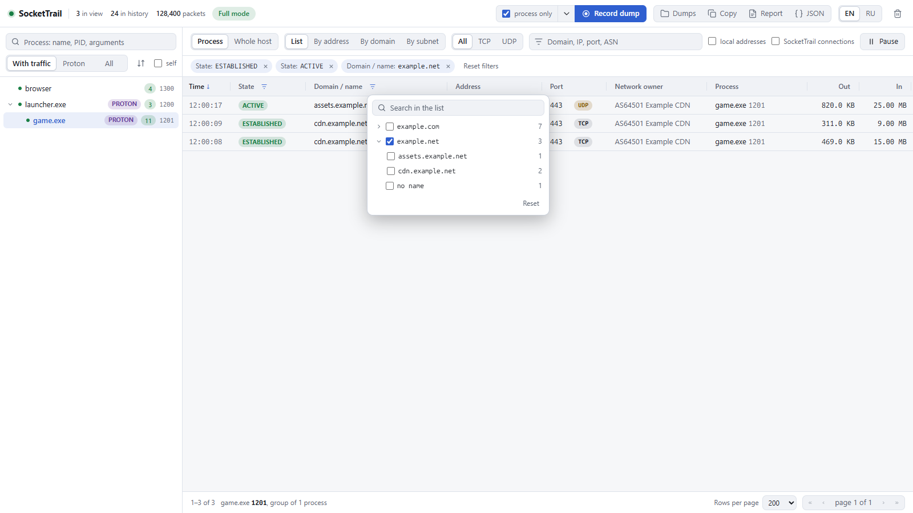
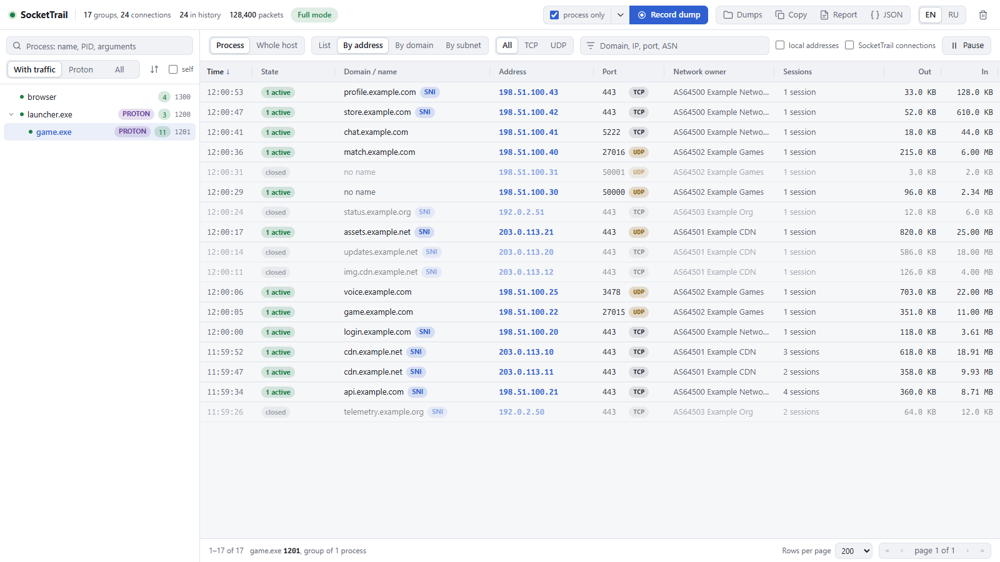
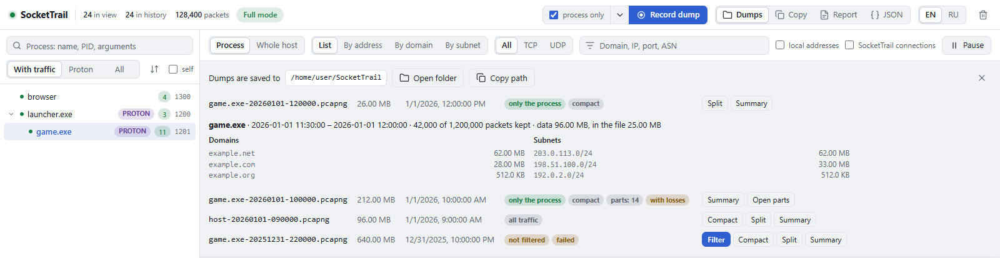

# Usage guide

**English** | [Русский](ru/usage.md) · [Back to README](../README.md)

- [The window](#the-window)
- [Picking a process](#picking-a-process)
- [The connection table](#the-connection-table)
- [Summaries](#summaries)
- [Dumps](#dumps)
- [Reports and export](#reports-and-export)
- [Where names and ports come from](#where-names-and-ports-come-from)
- [Command line](#command-line)
- [Background collection](#background-collection)
- [Language](#language)
- [Where data is stored](#where-data-is-stored)

## The window

SocketTrail opens its own window: Chrome, Chromium, Edge, Brave or Vivaldi in app
mode with a separate profile. It does not mix with your regular browser and has its
own taskbar icon. Without a Chromium-based browser a regular tab opens.

**Closing the window exits the program**: an unfinished dump is finalized, the name
cache is saved, capture is stopped. Ctrl+C and SIGTERM do the same. Running
SocketTrail again does not start a second copy: the window of the running one opens.

The header holds the counters (connections in view, in history, packets parsed), the
mode badge, the dump controls, **Dumps**, **Copy**, **Report**, **JSON**, the EN | RU
switch and the button that clears the history.

**Full mode** means packet capture works. **Basic mode** means it is off: only the
socket table remains, without traffic volume, UDP targets and dumps. On Windows a click
on the badge restarts the program as administrator, see
[Two modes](windows.md#two-modes).

## Picking a process

The left panel is a process tree that refreshes by itself.

- **With traffic**, **Proton** and **All** filter the tree; **self** also shows
  SocketTrail and its `dumpcap`. The **Proton** tab exists only on Linux. The search box
  matches the name, PID and arguments.
- The tree is ordered by name, so rows keep their places. The button with arrows next to
  the tabs orders it by connection count instead. A process stays under **With traffic**
  for 30 seconds after its last activity, so a pause in traffic does not hide it.
- A green dot means active connections, the number is the connection count, the
  PROTON badge marks programs under Proton or Wine.
- Selecting a process brings in all its descendants, so a game under Proton is seen
  together with its launcher chain. A dozen leaves with the same name, like browser
  tabs, collapse into one row such as `chrome x12`.
- When the selected process exits, its connections stay in the table and the line
  under the table says so.
- The tree works from the keyboard: the arrows move between rows, Right and Left
  expand and collapse a branch, Enter or Space selects a process.

## The connection table

**Process** shows the selected group, **Whole host** shows every connection of the
computer. **List** is the history row by row; **By address**, **By domain** and
**By subnet** are the [summaries](#summaries).

<picture>
  <source media="(prefers-color-scheme: dark)" srcset="images/filters-en-dark.png">
  
</picture>

- **Sorting.** A click on a column header sorts by it, the next click reverses the
  order. By default the newest connections are on top. The order uses the time a
  connection first appeared, which never changes, so existing rows do not swap places.
  With **Time** ascending new rows arrive at the bottom and nothing moves at all.
- **Filter by list.** The icon in a column header opens the values of that column with
  counters: state, domain, address, port, network owner, process. Subdomains are nested
  under their base domain and addresses under their subnet, so one checkbox on
  `example.com` or `203.0.113.0/24` covers everything inside. Values of one column
  combine as "or", different columns as "and".
- **Filter from a row.** A click on the state keeps only that state. The filter icons
  that appear over a row do the same for its domain, address and process. The next click
  on the same value removes the filter.
- Active filters appear as chips above the table. Each chip has its own remove button,
  and **Reset filters** removes them all.
- **Pause** freezes the rows. The counters in the header keep running; sorting, filters
  and pages still apply when you use them.
- **Pages.** The table shows 100, 200, 500 or 1000 rows per page, and the choice is
  remembered. Only the rows of the current page are transferred, so a long session stays
  responsive.
- Closed connections stay in the list. Rows marked **packets only** were caught by
  packet parsing and never showed up in the socket table: they lived shorter than the
  250 ms polling interval.
- The **SNI** badge means the name came from the TLS or QUIC handshake of this very
  connection, which is the most reliable source.
- The port cell carries a **TCP** or **UDP** badge. The **All / TCP / UDP** switch
  limits the table to one protocol.
- The filter box matches domain, IP, port, ASN and protocol: `udp` keeps UDP only.
- **local addresses** shows traffic to 127.0.0.53, mDNS, SSDP and other local
  targets; **SocketTrail connections** shows the program's own service traffic.
  Both are hidden by default.
- Column borders can be dragged. A double click on a border fits the column to the
  longest value. Widths are remembered, as is the width of the left panel.
- The copy icon over a row puts the domain or address into the clipboard.

Domains fill in gradually. A DNS response is seen once, when the program resolves the
name, so a connection opened before SocketTrail started gets its name from the cache,
from the next TLS handshake or from PTR. On Windows without administrator rights the
system DNS cache is polled every 3 seconds.

## Summaries

<picture>
  <source media="(prefers-color-scheme: dark)" srcset="images/by-address-en-dark.png">
  
</picture>

**By address** collapses the history by address and port: instead of three hundred
TIME_WAIT rows to one CDN node there is one row with the number of sessions, how many
are active now and the total traffic. **By domain** puts all subdomains of a base domain
on one row, which is the view to copy domains from when writing routing rules.
**By subnet** groups addresses by `/24` for IPv4 and `/48` for IPv6, which shows servers
without names.

A click on a row opens its connections in the list, and **Back to summary** returns to
the same place. Filters apply to summaries too.

## Dumps

<picture>
  <source media="(prefers-color-scheme: dark)" srcset="images/dumps-en-dark.png">
  
</picture>

**Record dump** writes `~/SocketTrail/<process>-<date>.pcapng` (on Windows
`%USERPROFILE%\SocketTrail`). **Dumps** in the header shows the folder, the recorded
files with their status, and what can still be done with each file.

- With **process only** checked, the file keeps the traffic of the selected process
  and its children, including connections opened after the recording started. The
  selection uses confirmed connection ownership retained throughout recording, so
  servers the game connects to later and older connections evicted from the live
  history are not lost. Packets with unknown or disputed ownership are excluded,
  even when their IP or domain matches a known connection. To inspect those packets,
  record the whole computer and use the unfiltered connection list.
- Such a recording stops by itself 15 seconds after the process exits: start it, play
  and do not watch it.
- Without the checkbox all traffic of the computer is recorded.

The arrow next to **process only** opens two settings, which are remembered:

- **Compact file** is on by default. The first 64 KiB of each flow and all DNS stay
  whole; later packets keep their headers and 16 bytes of data. Addresses, ports, times
  and original packet sizes remain, so Wireshark still shows every packet and the volume
  of each flow. The file usually becomes several times smaller. Turn the option off when
  the contents of every packet matter: removed data cannot be restored.
- **Split into parts** is **When large** by default. When the result exceeds 64 MiB, a
  `<dump>.parts` folder next to the dump gets one file per domain or subnet:
  `domain-example.com.pcapng`, `subnet-203.0.113.0-24.pcapng` and so on. The 64 largest
  groups get their own file, the rest goes to `other.pcapng`, and a part over 256 MiB
  continues in a `-2` file. The dump itself stays in place. **Always** and **Never**
  are the other choices.

On stop every packet is labeled with its process and domain. In Wireshark the label is
the `frame.comment` field: right-click it in the packet details and choose
**Apply as Column**, or filter with `frame.comment contains "game.exe"`. The same
works in `tshark`. The following is a synthetic example, not a real session:

```console
$ tshark -r game.exe-demo.pcapng -T fields -e frame.comment | sort | uniq -c | sort -rn | head -3
 120 game.exe [1201] -> cdn.example.com
  80 game.exe [1201] -> api.example.com
  40 game.exe [1201] -> updates.example.com
```

Two files are saved next to the dump. A week later they still tell what was recorded,
even if the process exited long before the recording was stopped.

| File | Contents |
|---|---|
| `<dump>.json` | summary that opens in any editor: the period, the process and the PIDs of its group, packet totals, domains with their subdomains and subnets with their addresses, largest first, warnings and parts |
| `<dump>.connections.jsonl` | one line per connection: domain, PTR, ASN, owner, traffic, packets and bytes counted from the file, and the name of its part |

The **Dumps** panel shows the status of each file: **only the process**, **all traffic**,
**not filtered** or **no details**, with **compact**, **parts**, **with losses** and
**failed** badges. **Summary** opens domains, subnets and parts right in the window, and
**Open parts** opens the folder with the parts. The other buttons process a recorded
file in place: **Filter** keeps the connections of the recorded process, **Compact**
reduces the file and **Split** creates the parts. **Compact** and **Split** do not
filter, so an unfiltered file keeps all its traffic and can still be filtered later.
This works for dumps of earlier versions too, and their summary is converted to the new
format. Filtering relies on the connection map saved with the dump, so a connection
missing from the map stays out of a process dump.

Losses during recording do not cancel the filter: the file is filtered anyway, and the
message on stop and the summary tell how many frames were lost. The recording button
is disabled while a request or finalization is in progress. If the file cannot be
rewritten or holds no packets of the process, the original remains unfiltered; the
window reports its path and the summary records `only_process: false`. Such a file may
contain traffic from the whole host.

## Reports and export

- **Report** saves a self-contained HTML file that opens without internet access.
- **JSON** saves the same data in a machine-readable form.
- Both follow the table: the scope (the selected process or the whole host), the
  filter box, the protocol switch, list filters, the sort order and the checkboxes for
  local addresses and SocketTrail connections. All matching rows are exported, not only
  the current page.
- **Copy** puts the rows of the current page into the clipboard as TSV, ready for a
  spreadsheet.

## Where names and ports come from

The port is always real. For live connections it is read from the socket table, for
connections caught by packet parsing from the TCP or UDP header. There are no
defaults and no guesses by service type: if the port is unknown, there is no row.

The name of an address comes from four sources, in order of reliability:

1. SNI from the ClientHello of the connection: TLS over TCP or QUIC.
2. DNS responses seen in the traffic, including CNAME chains.
3. The PTR record.
4. A label for special addresses: `127.0.0.53` is the system resolver itself and
   never has a domain.

A name from DNS replaces a PTR name if it arrives later. An existing connection
keeps its first DNS name until SNI replaces it. DNS cache entries survive a restart
until their TTL expires; simultaneous names for one IP remain ambiguous.

The network owner is the ASN and the name of the organization that announces the
address. It often differs from the PTR name: an address can have a PTR of one company
and be served by the network of another, so both are shown.

## Command line

| Option | Meaning |
|---|---|
| `-i`, `--iface <name>` | capture interface, several separated by commas. Linux only, default `any`. The own PktMon/ETW engine on Windows always uses all adapters |
| `--port <port>` | port of the local interface, default 8787. If another program holds it, the next free one is used |
| `--no-open` | start the server only, without a window |
| `--lang <en\|ru>` | language for this run |
| `-h`, `--help` | help |

## Background collection

To have the history build up before the window is opened, for example from login until
the game starts, run SocketTrail as a systemd user service:

```sh
systemctl --user enable --now sockettrail
```

`install.sh` and the `.deb` package install this unit disabled, with the path to
the installed binary, and `uninstall.sh` removes it. In this mode `dumpcap` runs all
the time and parses all traffic of the computer. Open the window with `sockettrail`
or the menu shortcut as usual: it connects to the running service, and closing it
does not stop the collection.

## Language

The interface is available in English and Russian, English by default. The EN | RU
switch in the header changes the window, the HTML report and log messages, and the
choice is saved. `--lang en|ru` sets the language at startup.

## Where data is stored

| | Linux | Windows |
|---|---|---|
| Dumps | `~/SocketTrail` | `%USERPROFILE%\SocketTrail` |
| Name cache, language, window profile | `~/.cache/sockettrail` | `%LOCALAPPDATA%\SocketTrail` |

The dump folder in the home directory is not the repository folder of the same name.
